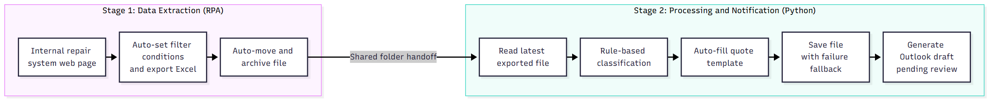

# Daily Repair Quote Automation System

**RPA + Python | Customer Service Repair Quote Workflow Automation**

> ⚠️ This project is an internally used tool at the company. For security reasons, only the architecture and design are described here — source code and data are not published.

---

## Background

In the customer service department, repair quotes and inspection notices for devices sent in by dealers had to be processed every day. The original process was entirely manual:

1. Log into the internal repair system, manually set a date range, and select multiple export fields
2. Export to Excel and filter out cases marked "pending quote"
3. Classify each case one by one as "quote," "inspection notice," or "refurbishment"
4. Copy and paste data row by row into different Excel quote templates
5. Save the files to a shared folder
6. Compose an email, paste the data as a table into the body, attach the quote, and send it

This was repetitive, multi-step, and error-prone — a single mismatched column could cause a mistake, and if the person familiar with the process was out, no one else could easily step in.

## Solution

The workflow was split into **two independent automated stages**, connected through a shared handoff folder:

**Why split it into two stages?** The two stages are fully independent. If the web export fails, the previous data can still be processed; if the processing stage fails, there's no need to re-export — this makes the system much easier to debug.

## Tech Stack

| Category | Tools |
| --- | --- |
| RPA | Power Automate Desktop |
| Web Automation | Chrome + JavaScript (direct DOM manipulation) |
| Data Processing | Python 3, openpyxl, regular expressions |
| Office Integration | Outlook COM automation (pywin32), Excel templates |
| Execution & Operations | Windows Batch one-click execution, execution logs |

## Features

### Stage 1: Automated Export

- Automatically opens the system page and dynamically calculates a "one month back from today" date range
- Uses JavaScript to select and sort multiple fields in one pass, automatically retrying when a field element can't be found
- Monitors the download folder and proceeds as soon as a new file appears, instead of waiting a fixed amount of time
- Automatically moves the exported file to the designated folder

### Stage 2: Classification, Template Filling, and Notification

- **Auto-classification**: cases are sorted into "quote / inspection notice / refurbishment" based on case number patterns and remark content
- **Amount parsing**: extracts repair line items and amounts from free-text remarks (e.g. formats like "item A + item B = XXX + YYY") and maps them to the corresponding rows in the template
- **Template filling**: generates one quote sheet per case; inspection notices dynamically rebuild formulas based on the actual number of rows, and unused rows are automatically hidden
- **Save with fallback**: if writing to the network drive fails, the file is automatically saved locally instead, with the reason logged
- **Email draft generation**: automatically produces an HTML table in the email body, applies the company signature, and attaches the quote — **only creates a draft, never sends automatically**; a human reviews and sends it manually

## Technical Challenges Solved

| Problem | Solution |
| --- | --- |
| The recorded RPA flow would hang on the date picker control | Switched to writing the date value directly into the date field via JavaScript, bypassing the calendar popup |
| Fixed wait times for downloads — too short caused failures, too long wasted time | Record the files already present before export, then poll every second afterward; proceed as soon as a new file appears, with a cap of tens of seconds |
| Inconsistent remark formats (itemized amounts, total only, multiple non-standard items) | Designed multiple parsing patterns; items without a matching template row borrow an empty row and rename it, preventing data loss |
| Network drive occasionally inaccessible | Built a fallback mechanism that saves locally instead, with logging for later investigation |
| User machines without admin rights, inconsistent environments | The batch script auto-detects Python and installs packages within the project folder, requiring no admin privileges |
| Risk of sending an email with incorrect data | Adopted a "human in the loop" design: the system only prepares a draft, and the final send step always requires human confirmation |

## Security Design Principles

- All data is processed only on local machines and the internal company network — **nothing is uploaded to any cloud service**
- Credentials are never hardcoded into the program
- All emails go through human review before being sent

## Results

- In daily use in production, running reliably every day
- What used to require row-by-row copy-pasting is now reduced to "run → review draft → send"
- The process is standardized, so staff other than the original owner can run it as well

## Future Plans

- Schedule fully automated daily execution via Windows Task Scheduler
- Add automated login to achieve full unattended operation
- Introduce AI-based interpretation of ambiguous repair remarks to improve auto-classification accuracy
- Extend support to more dealer quote formats
